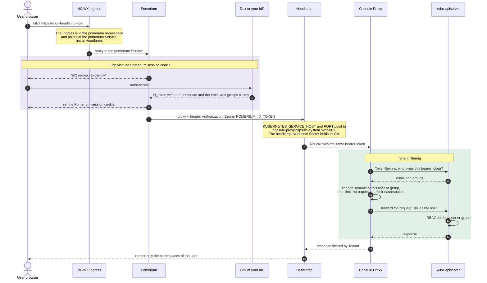
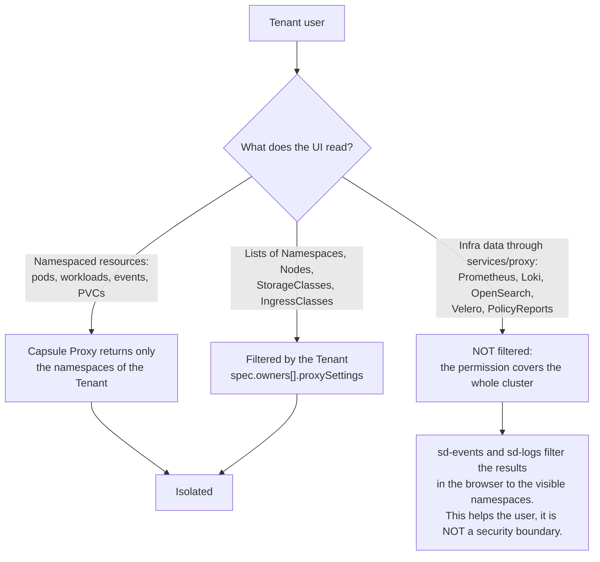

# Example: Headlamp behind SSO (Pomerium) with Capsule multitenancy

<!-- <SD-DOCS> -->

In this example Headlamp is behind an **SSO proxy** (Pomerium), and the API requests go
through **Capsule Proxy**, so that each tenant is isolated. The same identity, the OIDC
`id_token` of the user, is used from the browser to the API server. Each user sees only the
namespaces that their Capsule Tenant allows.

Headlamp does not do the login itself (it runs without the `-oidc-*` flags). Pomerium does
the login and gives the token to Headlamp.

## At a glance

| | |
| --- | --- |
| **Entry point** | NGINX Ingress → **Pomerium** (the Ingress is in the `pomerium` namespace) |
| **Login** | Full OIDC redirect flow to your identity provider (Dex on a default SD cluster) |
| **Identity at the API server** | The **real user**: the `email` claim is the username, the `groups` claim gives the groups |
| **Who authorizes** | Capsule Proxy (tenant filtering) **and** kube-apiserver RBAC |
| **Tenant isolation** | **Yes, for namespaced resources**. See the diagram in [Capabilities and multitenancy](#capabilities-and-multitenancy) |
| **Audit trail per user** | **Yes**: the API server audit logs show the email of the user |
| **Extra components required** | Pomerium and an OIDC identity provider, **Capsule and Capsule Proxy**. The kube-apiserver must trust the identity provider |
| **Good for** | Clusters shared by many teams, where each team must see only its own namespaces |

## On SIGHUP Distribution

The distribution does **not** render this model. `spec.distribution.modules.utilities.headlamp.type`
supports only `token-auth` and `sso`, and `sso` is the [`oidc-rbac`](../oidc-rbac) model,
without Capsule. To use this example on an SD cluster:

- Keep `utilities.headlamp.type: none` and apply this overlay by hand. With `sso`, the
  distribution creates its own `headlamp` Ingress in the `pomerium` namespace, its own
  Pomerium route and its own RBAC, and they conflict with this overlay.
- Add the Pomerium route yourself in `spec.distribution.modules.auth.pomerium.routes`
  (prerequisite 1).
- Configure the API server to accept the `pomerium` audience yourself (item 5). The
  distribution adds the `pomerium` audience only when `headlamp.type` is `sso`.

## Authentication flow



Every request goes through two separate checks. Capsule Proxy decides *which objects* come
back, and the RBAC of the API server decides *if the user can read them*. A user needs both.

## Capabilities and multitenancy

The isolation is **not the same for every resource**: it depends on what the UI reads. This
is the most important thing to understand about this model:



What a tenant user gets:

| Area | Isolated? | Behaviour |
| --- | --- | --- |
| Pods, workloads, events, PVCs in the namespaces | **Yes** | Capsule Proxy returns only the namespaces of the Tenant |
| Namespace list | **Yes** | Only the namespaces of the Tenant |
| Node list and node CPU and memory tiles | **Yes**, through Capsule | The Tenant needs `Nodes: List` in `proxySettings`. Capsule Proxy reads the metrics with its own ServiceAccount, so tenant users do **not** need permissions on `nodes` or `metrics.k8s.io` |
| sd-core landing page | Partly | The distribution data comes from the `furyctl-*` Secrets in `kube-system`. All the tenant users can read them |
| sd-alerts, sd-certificates | **No** | Prometheus returns data for the whole cluster |
| sd-events, sd-logs | **Only in the browser** | The query to the backend covers the whole cluster. The UI then shows only the visible namespaces |
| sd-backups, sd-policy | **No** | The UI lists all the Velero backups and all the PolicyReports of the cluster |
| Changes | Depends on RBAC | Capsule decides *where*, your RBAC decides *if*. The RBAC below is read only |

If tenants must not see the monitoring, backup and policy data of other tenants, this
example is not enough. You need backends with data for each tenant, or a proxy that checks
the permissions in front of each data source. This is not covered here, and it needs changes
in the plugins for the cluster scoped resources.

## What this overlay adds to the base `headlamp` package

This overlay starts from the base package (`../../katalog/headlamp`) and adds:

| Resource | Purpose |
| --- | --- |
| Deployment patch (`patch-deployment.yaml`) | Points Headlamp at Capsule Proxy (`capsule-proxy.capsule-system.svc:9001`). It mounts a projected ServiceAccount token and the `headlamp-ca-bundle` CA, so that Headlamp trusts the TLS certificate of Capsule Proxy |
| `Ingress` (`ingress.yaml`, namespace `pomerium`) | Sends the Headlamp hostname to the **Pomerium** Service, not to Headlamp |

## Cluster prerequisites

This overlay contains **only the Headlamp resources**. Before you apply it, the cluster must
already have the following:

1. **An SSO proxy (Pomerium) with an OIDC identity provider.** Pomerium must be installed
   and reachable, with an OIDC identity provider (for example Dex). It must have a **route
   for the Headlamp host** that sends the requests to the Headlamp Service and adds the token
   of the user.

   **Where to add the route:** in the route configuration of your Pomerium instance, that is
   the `routes` (or `policy`) list in the Pomerium `ConfigMap` or `Secret` in the `pomerium`
   namespace. If another tool generates the Pomerium configuration, change it in that tool
   and apply it again. Do **not** change the generated object by hand, because the tool
   overwrites it. On a **SIGHUP Distribution** cluster, add the route to the
   `spec.distribution.modules.auth.pomerium.routes` list of the configuration file. The old
   `spec.distribution.modules.auth.pomerium.policy` string field still works, but it is
   **deprecated**: use `routes` and `defaultRoutesPolicy`.

   The route to add:

   ```yaml
   # <YOUR_HEADLAMP_HOST> must be the same as the host of the Ingress
   - from: https://<YOUR_HEADLAMP_HOST>
     to: http://headlamp.headlamp.svc.cluster.local:80
     set_request_headers:
       Authorization: "Bearer ${pomerium.id_token}"   # Pomerium puts the id_token of the user here
     allow_websockets: true        # required for exec and log streaming
     preserve_host_header: true
     policy:
       - allow:
           and:
             - authenticated_user: true
   ```

2. **Capsule and Capsule Proxy**, for the tenant filtering. This overlay expects Capsule
   Proxy at `capsule-proxy.capsule-system.svc:9001`. If your address is different, change
   `patch-deployment.yaml`.

   Capsule is **not** part of SIGHUP Distribution. On an SD cluster you can install it as a
   furyctl plugin: a `plugins.helm` release of the `projectcapsule/capsule` chart with
   `proxy.enabled: true`.

3. **A kube-apiserver that accepts the OIDC tokens.** It must trust the OIDC issuer and
   accept the audience of the tokens of the proxy (usually `pomerium`). The `email` claim must
   be the username and the `groups` claim must give the groups (Capsule finds the tenants
   from the groups). See item 5 in [What you must provide](#what-you-must-provide) for the
   audience.

4. **At least one Capsule `Tenant`** with `spec.owners` that match your users or groups, and
   with `proxySettings` that allow the list of the nodes (without it, the sd-core node tiles
   are empty):

   ```yaml
   apiVersion: capsule.clastix.io/v1beta2
   kind: Tenant
   metadata:
     name: <tenant-name>
   spec:
     owners:
       - name: <user-email-or-group>
         kind: User        # or Group
         proxySettings:
           - kind: Nodes
             operations: [List]          # sd-core node tiles
           - kind: StorageClasses
             operations: [List]
           - kind: IngressClasses
             operations: [List]
   ```

5. **The `headlamp-ca-bundle` Secret** in the `headlamp` namespace, so that Headlamp trusts
   the TLS certificate of Capsule Proxy. The `ca.crt` key must contain the CA that signs the
   certificate of Capsule Proxy:

   ```shell
   kubectl create namespace headlamp --dry-run=client -o yaml | kubectl apply -f -
   # Capsule Proxy stores its CA in the capsule-system/capsule-proxy Secret (key: ca):
   kubectl get secret capsule-proxy -n capsule-system -o jsonpath='{.data.ca}' \
     | base64 -d > /tmp/capsule-ca.crt
   kubectl create secret generic headlamp-ca-bundle -n headlamp \
     --from-file=ca.crt=/tmp/capsule-ca.crt \
     --dry-run=client -o yaml | kubectl apply -f -
   ```

## What you must provide

This table lists all the inputs of this overlay. The last column says where the same value
is on a SIGHUP Distribution cluster. The distribution field names were checked against
**SD v1.36.0**. Of the three examples, this one needs the most inputs.

| # | Input | Where you set it | Example | On a SIGHUP Distribution cluster |
| --- | --- | --- | --- | --- |
| 1 | **Headlamp hostname** | `ingress.yaml` → `spec.rules[0].host`, the `cluster.kfd.sighup.io/useful-link.url` annotation **and** `spec.tls[0].hosts[0]`. It must be the same as the `from:` host of the Pomerium route | `headlamp.example.com` | any host under `spec.distribution.modules.ingress.baseDomain` |
| 2 | **Ingress class and TLS source** | `ingress.yaml` → `spec.ingressClassName`, and the `cert-manager.io/cluster-issuer` annotation (placeholder `example-issuer`). As an alternative, create the Secret named in `spec.tls[0].secretName` yourself | `nginx` / `letsencrypt-prod` | `spec.distribution.modules.ingress.nginx.type`, `spec.distribution.modules.ingress.certManager.clusterIssuer.name` |
| 3 | **Pomerium route for the Headlamp host** | The route configuration of Pomerium (prerequisite 1). It is **not** part of this overlay | see prerequisite 1 | `spec.distribution.modules.auth.pomerium.routes` (`spec.distribution.modules.auth.pomerium.policy` is deprecated). The distribution does not create it, because `utilities.headlamp.type` must be `none` |
| 4 | **Capsule Proxy address**, that Headlamp uses *instead of* the API server | `patch-deployment.yaml` → env `KUBERNETES_SERVICE_HOST` and `KUBERNETES_SERVICE_PORT` | `capsule-proxy.capsule-system.svc` / `9001` | no distribution field |
| 5 | **OIDC trust of the kube-apiserver**: issuer URL, accepted audience (`pomerium`), issuer CA, and the mapping of the `email` and `groups` claims | The API server configuration: the `--oidc-*` flags or an `AuthenticationConfiguration` file | issuer `https://login.example.com`, audience `pomerium`, `username_claim: email`, `groups_claim: groups` | **OnPremises and Immutable**: `spec.kubernetes.advanced.oidc.{issuer_url, client_id, ca_file, username_claim, groups_claim, groups_prefix}`. **KFDDistribution**: the spec has no `kubernetes` section, you manage the cluster. **EKSCluster**: no furyctl field, use an EKS OIDC identity provider association. See [the note on audiences](#note-on-item-5-audiences) |
| 6 | **Capsule Proxy CA** in the `headlamp-ca-bundle` Secret of the `headlamp` namespace, key `ca.crt` | You create it with `kubectl` (prerequisite 5). The projected volume in `patch-deployment.yaml` mounts it | CA from `capsule-system/capsule-proxy`, key `ca` | no distribution field. Update the Secret when the Capsule Proxy certificate changes |
| 7 | **Capsule `Tenant` resources**: owners and `proxySettings` | Resources that you write (prerequisite 4) | `Nodes: List` for the sd-core node tiles | no distribution field. Capsule is a furyctl plugin, not a distribution module |
| 8 | **Tenant group for RBAC** | `<YOUR_TENANT_GROUP>` in the RBAC example below | `capsule.clastix.io` | it must be one of the `manager.options.capsuleUserGroups` of the Capsule chart (default: `capsule.clastix.io` and `oidc:capsule.clastix.io`) **and** be in the `groups` claim of the user |
| 9 | **Service names of the observability backends** | `services/proxy` `resourceNames` in the RBAC example. You need both the plain name and the name with the port | `loki-stack`, `loki-stack:3100` | the defaults match the Services of the SD modules. Change them if you changed the Services |
| 10 | **Image tag** (optional) | `../../katalog/headlamp/kustomization.yaml` → `images:` transformer | `registry.sighup.io/fury/sd-ui:<tag>` | set by the distribution version |

### Note on item 5: audiences

The `--oidc-client-id` flag of the API server accepts **only one audience**. If you set it to
`pomerium`, the API server accepts **only** `pomerium`. The other OIDC clients of the cluster
stop working, for example Gangplank, which creates kubeconfig files with its own client ID.

To accept more than one audience, the API server needs an `AuthenticationConfiguration`
(`apiserver.config.k8s.io/v1`) with `audiences: [...]` and `audienceMatchPolicy: MatchAny`,
passed with `--authentication-config`. The [`oidc-rbac` note](../oidc-rbac/README.md#note-on-item-4-audiences)
shows an example of this file.

On SD **OnPremises** and **Immutable** clusters (installers v1.36.5 and later), the
installers create this file from `spec.kubernetes.advanced.oidc`. The distribution adds the
`pomerium` audience **only when `utilities.headlamp.type` is `sso`**, but this example needs
`none`. So with the configuration file, the only option is `client_id: pomerium`, with the
limit described above.

The groups prefix is also important. Capsule compares the groups of the user with the prefix,
so the `Tenant` owners and the RBAC group (items 7 and 8) must use the name with the prefix.
On SD OnPremises and Immutable clusters, the prefix is `groups_prefix`, and the default is
`oidc:`. The default `capsuleUserGroups` of the Capsule chart already contains
`oidc:capsule.clastix.io`.

## RBAC for tenant users

Capsule Proxy limits the **namespaced** resources (pods, workloads, events in the namespaces
of the tenant) to the Tenant. But most SD plugins also read data that is **cluster scoped or
in other namespaces** (configuration Secrets, infra services through the proxy, cluster
scoped reports). Capsule does not give these permissions to a tenant user. Grant them to the
group of the `groups` claim (with Capsule, the users are members of `capsule.clastix.io`).

The minimum permissions for all the UI features, to bind to `<YOUR_TENANT_GROUP>`:

```yaml
# Namespaced: read the SD configuration Secrets (module detection, sd-core landing page)
apiVersion: rbac.authorization.k8s.io/v1
kind: Role
metadata:
  name: sd-ui-config-reader
  namespace: kube-system
rules:
  - apiGroups: [""]
    resources: ["secrets"]
    resourceNames: ["furyctl-kfd", "furyctl-config"]
    verbs: ["get"]
---
apiVersion: rbac.authorization.k8s.io/v1
kind: ClusterRole
metadata:
  name: sd-ui-reader
rules:
  - apiGroups: ["networking.k8s.io"]     # sd-core "useful links"
    resources: ["ingresses"]
    verbs: ["get"]
  - apiGroups: [""]                        # sd-alerts, sd-certificates, sd-core (Prometheus)
    resources: ["services/proxy"]
    resourceNames: ["prometheus-k8s", "prometheus-k8s:9090"]
    verbs: ["get", "create"]              # create is for the POST proxy calls (for example query_range)
  - apiGroups: [""]                        # sd-events, sd-logs (Loki or OpenSearch)
    resources: ["services/proxy"]
    resourceNames: ["loki-stack", "loki-stack:3100", "opensearch-cluster-master", "opensearch-cluster-master:9200"]
    verbs: ["get", "create"]
  - apiGroups: ["velero.io"]               # sd-backups
    resources: ["backups", "schedules", "restores"]
    verbs: ["get", "list"]
  - apiGroups: ["wgpolicyk8s.io"]          # sd-policy (Kyverno)
    resources: ["policyreports", "clusterpolicyreports"]
    verbs: ["get", "list"]
  - apiGroups: ["constraints.gatekeeper.sh"]   # sd-policy (Gatekeeper). The constraint kinds
    resources: ["*"]                           # are dynamic CRDs, so the wildcard is required
    verbs: ["get", "list"]
# Add a RoleBinding (in kube-system) and a ClusterRoleBinding that bind <YOUR_TENANT_GROUP>
# to the Role and the ClusterRole above.
```

Keep only the rules for the modules that you use (for example, remove the OpenSearch names
if you use Loki, or the Gatekeeper rule if you use Kyverno).

**Capsule handles the nodes and the node metrics, not this RBAC.** The sd-core overview
lists the nodes through the **`proxySettings` of the Tenant** (`Nodes: List`), and **Capsule
Proxy reads the node metrics** (`metrics.k8s.io`) with its own ServiceAccount. For this
reason tenant users do **not** need permissions on `nodes` or `metrics.k8s.io` for those
tiles.

### Cluster scoped resources and filtering in the browser

Some of the reads above are **for the whole cluster** by nature: node and cluster policy
reports, Gatekeeper constraints, and the Prometheus, Loki, OpenSearch and Velero endpoints,
which are in infra namespaces and not in the namespaces of the tenant. So these permissions
are **not filtered by tenant**, and this has two consequences:

- A tenant user can query **all** the metrics and logs, and list **all** the Velero backups
  and **all** the PolicyReports of the cluster, not only the ones of their namespaces.
- The UI filters some of this data **only in the browser**: sd-events and sd-logs show only
  the namespaces of the namespace list (which Capsule filters), but the proxy permission
  still allows queries on everything. **Filtering in the browser helps the user, it is not a
  security boundary.** Capsule Proxy still isolates the namespaced resources (pods,
  workloads, events *in* the namespaces of the tenant).

## Logout

Behind an SSO proxy the Headlamp logout does nothing. For this reason `sd-core` hides it and
shows a sign out button that opens:

```text
/.pomerium/sign_out?pomerium_redirect_uri=https://<your-headlamp-host>/
```

Pomerium deletes the session and sends the browser back to Headlamp. There is no session
anymore, so the OIDC flow starts again and the user sees the Dex login form. Without
`pomerium_redirect_uri`, the user sees the "signed out" page of Pomerium.

Check two things if you do **not** use Dex:

- If the identity provider has an `end_session_endpoint` in its discovery document, Pomerium
  sends that URL as `post_logout_redirect_uri`. Most identity providers reject or ignore a
  value that is not registered on the client, so register `https://<your-headlamp-host>/`
  there. Dex does not have this endpoint, so this does not apply to a default SD cluster.
- If the identity provider keeps its own SSO cookie, it logs the user in again without a
  prompt, and the logout seems to do nothing. This depends on the identity provider, not on
  this overlay. Dex has no browser session for the password and LDAP connectors, so it asks
  for the credentials again.

## Placeholders to set before you apply

- **Hostname.** In `ingress.yaml`, replace `headlamp.example.com` in the rule host, in the
  `cluster.kfd.sighup.io/useful-link.url` annotation and in `tls.hosts`. It must be the same
  as the `from:` host of the Pomerium route (prerequisite 1).
- **TLS issuer.** The Ingress has the `cert-manager.io/cluster-issuer: example-issuer`
  annotation, which is a placeholder. Set your `ClusterIssuer`, or remove the annotation and
  create the TLS Secret named in `tls.secretName` yourself.
- **Capsule Proxy address.** Only if it is not the default in `patch-deployment.yaml`.
- **Image (optional).** Set a different build with the `images:` transformer in
  `../../katalog/headlamp/kustomization.yaml`.

## Deploy

From the root of the repository:

```shell
kustomize build examples/oidc-capsule | kubectl apply -f -
```

## Verify

Open `https://<your-host>`. The browser goes to the identity provider for the login. After
the login, Headlamp shows **only the namespaces of your Capsule Tenant**. A user with a
binding on the whole cluster sees everything.

Common problems:

| Symptom | Probable cause |
| --- | --- |
| The Headlamp pod logs show `x509: certificate signed by unknown authority` | The `headlamp-ca-bundle` Secret is missing or contains the wrong CA (item 6) |
| The login works but every page is empty | The API server rejects the token: wrong issuer, audience or CA (item 5) |
| The login works but there are no namespaces | No Capsule `Tenant` has this user or group as owner (item 7) |
| The namespaces are there but the node tiles are empty | The Tenant does not have `Nodes: List` in `proxySettings` (item 7) |
| Everything works except alerts, logs or events | The `services/proxy` permissions are missing, or the `resourceNames` with the port are missing (item 9) |

<!-- </SD-DOCS> -->

## License

This package is governed by a BSD-style license. See the [LICENSE](../../LICENSE) file.
