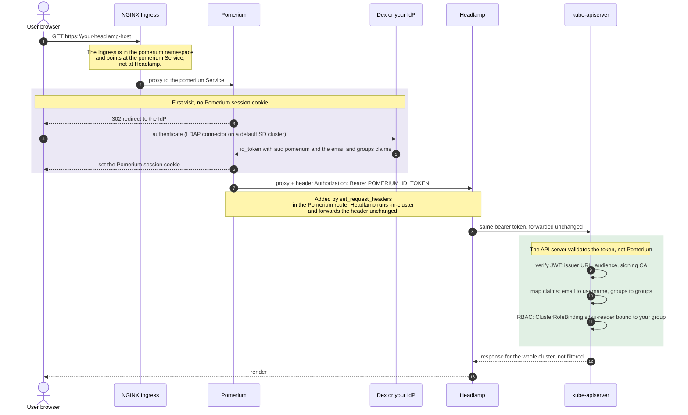
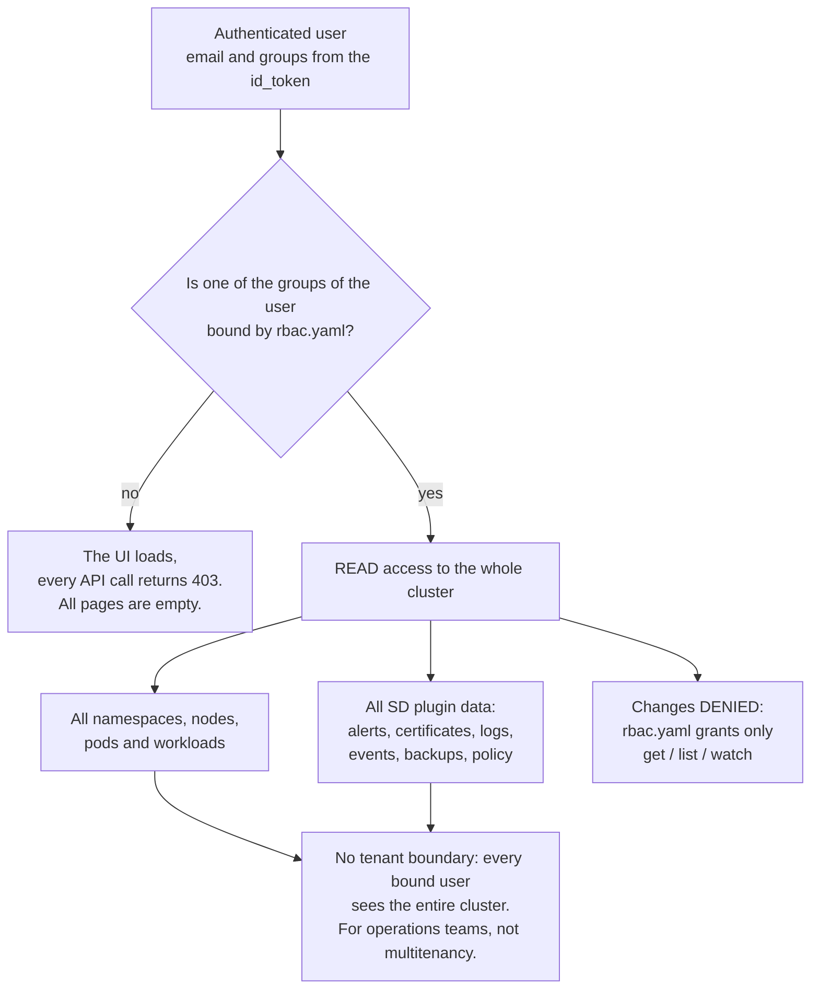

# Example: Headlamp behind SSO with OIDC group RBAC, without Capsule

<!-- <SD-DOCS> -->

This overlay puts Headlamp behind **Pomerium SSO**. Each user reaches the Kubernetes API
server **with their own identity**, and plain Kubernetes RBAC decides what they can see.
The cluster does **not** need Capsule.

There are three examples, and this one is in the middle:

- [`token-auth`](../token-auth): the user logs in with a Kubernetes token. It is simple, but
  pasting a token is not easy for users who are not familiar with Kubernetes.
- [`oidc-capsule`](../oidc-capsule): SSO **with** Capsule Proxy, so that each tenant sees only
  its own namespaces.
- **`oidc-rbac` (this example)**: SSO **without** Capsule. RBAC is per user and per group, but
  there is no tenant isolation (see [Scope](#scope)).

## At a glance

| | |
| --- | --- |
| **Entry point** | NGINX Ingress → **Pomerium** (the Ingress is in the `pomerium` namespace) |
| **Login** | Full OIDC redirect flow to your identity provider (Dex on a default SD cluster) |
| **Identity at the API server** | The **real user**: the `email` claim is the username, the `groups` claim gives the groups |
| **Who authorizes** | kube-apiserver RBAC, bound to an OIDC **group** that you choose |
| **Tenant isolation** | **None**: the bound users can read the whole cluster |
| **Audit trail per user** | **Yes**: the API server audit logs show the email of the user |
| **Extra components required** | Pomerium and an OIDC identity provider. The kube-apiserver must trust that provider |
| **Good for** | Operations teams where everybody must see the whole cluster, with named identities |

## On SIGHUP Distribution

From SD v1.36.0, on **OnPremises** and **Immutable** clusters, the distribution renders this
example for you when you set the Headlamp type to `sso`. You do not need to apply it by hand:

```yaml
spec:
  distribution:
    modules:
      auth:
        provider:
          type: sso          # required by headlamp.type sso
      utilities:
        headlamp:
          type: sso
          oidcGroup: authors # the OIDC group that gets read access, without the prefix
```

The distribution sets all the inputs listed in [What you must provide](#what-you-must-provide):

| This example | What the distribution does |
| --- | --- |
| `ingress.yaml` (host `headlamp.example.com`) | It creates the Ingress in the `pomerium` namespace at `dashboard.<baseDomain>`, with the ingress class and the TLS settings of the cluster |
| The Pomerium route (see [Requirements](#requirements)) | It adds the route. The default policy is `authenticated_user: true`. To change it, set `spec.distribution.modules.auth.pomerium.defaultRoutesPolicy.headlamp` |
| `rbac.yaml`, group `sd-ui-viewers` | It binds the same roles to `<groups prefix><oidcGroup>`. The groups prefix is `spec.kubernetes.advanced.oidc.groups_prefix` (or the deprecated `group_prefix`). The default is `oidc:` |
| `services/proxy` `resourceNames` | It includes only the backends installed on the cluster (Prometheus, Loki, OpenSearch). If no backend is installed, it does not create the `sd-ui-service-proxy` role |
| kube-apiserver audience (item 4) | If `spec.kubernetes.advanced.oidc.client_id` is not `pomerium`, the distribution adds `pomerium` as an extra audience (`oidc_extra_audiences`). The installer writes it in the API server `AuthenticationConfiguration`. You still configure the issuer and the claims in `spec.kubernetes.advanced.oidc` |
| Pod placement | It schedules Headlamp on the infra nodes, like the other modules |

The utilities module is not available on the `EKSCluster` and `KFDDistribution` kinds. On
those kinds, or on a cluster that is not SD, apply this example by hand as described below.

## Authentication flow



The base Deployment already runs `-in-cluster` against the real API server, so **you do not
need to patch the Deployment**. This overlay adds only the Ingress and the RBAC resources.
Capsule Proxy is not in the path. This is not a problem, because in every model the API
server, and not Capsule, validates the token.

## Capabilities and multitenancy



What a bound user gets:

| Area | Behaviour |
| --- | --- |
| Namespaces / workloads / nodes | **Everything in the cluster** |
| sd-core landing page | Full, with the node CPU and memory tiles (`rbac.yaml` grants `metrics.k8s.io`) |
| sd-alerts, sd-certificates | Full (Prometheus through `services/proxy`) |
| sd-events, sd-logs | Full, for the whole cluster (Loki or OpenSearch through `services/proxy`) |
| sd-backups, sd-policy | Full, for the whole cluster |
| Changes (scale, delete, exec, port forward) | **Denied**, because the RBAC in this example is read only. Extend `rbac.yaml` if you want to allow them |
| Identity per user | **Yes**: the API server attributes every request to the email of the user |
| Multitenancy | **Not supported**, see [Scope](#scope) |

## Requirements

- `auth.provider.type: sso`, so that Pomerium and Dex are installed.
- **The kube-apiserver must trust your OIDC issuer and accept the audience of the tokens that
  Pomerium forwards.** Pomerium gets an id_token with `aud: pomerium`, so `pomerium` must be
  an accepted audience. The configuration depends on the cluster, see
  [What you must provide](#what-you-must-provide), item 4.
- A Pomerium route for the Headlamp host that adds the bearer token, for example:

  ```yaml
  - from: https://headlamp.<base-domain>
    to: http://headlamp.headlamp.svc.cluster.local:80
    set_request_headers:
      Authorization: "Bearer ${pomerium.id_token}"
    allow_websockets: true
    preserve_host_header: true
    policy:
      - allow:
          and:
            - authenticated_user: true
  ```

  Log streaming and `exec` need `allow_websockets: true`.

## What you must provide

This table lists all the inputs of this overlay. The last column says where the same value
is on a SIGHUP Distribution cluster. The distribution field names were checked against
**SD v1.36.0**.

| # | Input | Where you set it | Example | On a SIGHUP Distribution cluster |
| --- | --- | --- | --- | --- |
| 1 | **Headlamp hostname** | `ingress.yaml` → `spec.rules[0].host`, the `cluster.kfd.sighup.io/useful-link.url` annotation **and** `spec.tls[0].hosts[0]`. It must be the same as the `from:` host of the Pomerium route | `headlamp.example.com` | always `dashboard.<spec.distribution.modules.ingress.baseDomain>` |
| 2 | **Ingress class and TLS source** | `ingress.yaml` → `spec.ingressClassName`, and the `cert-manager.io/cluster-issuer` annotation (placeholder `example-issuer`). As an alternative, create the Secret named in `spec.tls[0].secretName` yourself | `nginx` / `letsencrypt-prod` | taken from `spec.distribution.modules.ingress` (ingress class, TLS provider, cert-manager `ClusterIssuer`) |
| 3 | **Pomerium route for the Headlamp host** | The route configuration of Pomerium (see the example above). It is **not** part of this overlay | see above | created by the distribution. To change its policy, set `spec.distribution.modules.auth.pomerium.defaultRoutesPolicy.headlamp` |
| 4 | **OIDC trust of the kube-apiserver**: issuer URL, accepted audience (`pomerium`), issuer CA, and the mapping of the `email` and `groups` claims | The API server configuration: the `--oidc-*` flags or an `AuthenticationConfiguration` file | issuer `https://login.example.com`, audience `pomerium`, `username_claim: email`, `groups_claim: groups` | **OnPremises and Immutable**: `spec.kubernetes.advanced.oidc.{issuer_url, client_id, ca_file, username_claim, groups_claim, groups_prefix}`. The distribution adds the `pomerium` audience. **KFDDistribution**: the spec has no `kubernetes` section, you manage the cluster. **EKSCluster**: no furyctl field, use an EKS OIDC identity provider association. See [the note on audiences](#note-on-item-4-audiences) |
| 5 | **OIDC group to grant** | `rbac.yaml` → replace **every** `sd-ui-viewers` placeholder (two `ClusterRoleBinding` and one `RoleBinding`). Add the groups prefix of the API server, if there is one (see [RBAC](#rbac)) | an LDAP group CN that your Dex connector sends | `spec.distribution.modules.utilities.headlamp.oidcGroup`, without the prefix. The distribution adds the prefix. The groups come from the connector in `spec.distribution.modules.auth.dex.connectors` |
| 6 | **Service names of the observability backends** | `rbac.yaml` → `services/proxy` `resourceNames`. You need both the plain name and the name with the port | `loki-stack`, `loki-stack:3100` | computed from the installed monitoring and logging modules |
| 7 | **Image tag** (optional) | `../../katalog/headlamp/kustomization.yaml` → `images:` transformer | `registry.sighup.io/fury/sd-ui:<tag>` | set by the distribution version |

### Note on item 4: audiences

The `--oidc-client-id` flag of the API server accepts **only one audience**. If you set it to `pomerium`, the API server
accepts **only** `pomerium`. The other OIDC clients of the cluster stop working, for example
Gangplank, which creates kubeconfig files with its own client ID.

To accept more than one audience, the API server needs an `AuthenticationConfiguration`
(`apiserver.config.k8s.io/v1`) with `audiences: [...]` and `audienceMatchPolicy: MatchAny`,
passed with `--authentication-config`:

```yaml
apiVersion: apiserver.config.k8s.io/v1
kind: AuthenticationConfiguration
jwt:
  - issuer:
      url: https://login.<base-domain>
      audiences: [pomerium, oidc-auth-client]
      audienceMatchPolicy: MatchAny
      certificateAuthority: |
        <PEM of the CA that signs the TLS certificate of the identity provider>
    claimMappings:
      username: { claim: email, prefix: "" }
      groups:   { claim: groups, prefix: "" }
```

On SD **OnPremises** and **Immutable** clusters (from SD v1.36.0, installers v1.36.5) you do
not need to write this file. The installers create the `AuthenticationConfiguration` from
`spec.kubernetes.advanced.oidc`. With `utilities.headlamp.type: sso`, the distribution adds
`pomerium` to the accepted audiences, together with `client_id`, so Gangplank and the other
OIDC clients continue to work. On other clusters you must write the file yourself.

## RBAC

`rbac.yaml` binds the read permissions of the SD plugins to a **real OIDC group** from the
`groups` claim of the user. Before you apply it, replace every `sd-ui-viewers` placeholder
with a group that your Dex connector sends (for example an LDAP group CN). Do **not** use
`capsule.clastix.io`: that group exists only when Capsule Proxy is in the path.

The binding must use the group name **as the API server sees it**. If the API server adds a
groups prefix (`claimMappings.groups.prefix`, or `--oidc-groups-prefix`), add the prefix to
the name. On SD OnPremises and Immutable clusters, the default prefix is `oidc:`. For
example, the Dex group `authors` becomes `oidc:authors`.

All the permissions are read only:

| Object | Scope | Grants |
| --- | --- | --- |
| `ClusterRole/sd-ui-reader` | cluster | core resources, `metrics.k8s.io` nodes, `apps` workloads, ingresses, Kyverno `policyreports` and `clusterpolicyreports`, Gatekeeper constraints (`*`), Velero `backups`, `schedules` and `restores` |
| `ClusterRole/sd-ui-service-proxy` | cluster | `services/proxy` to Prometheus, Loki and OpenSearch. The default `view` role does not include it |
| `Role/sd-ui-furyctl-secrets-reader` | `kube-system` | `get` on the `furyctl-kfd` and `furyctl-config` Secrets only (`view` does not include Secrets) |

## Logout

Behind an SSO proxy the Headlamp logout does nothing. For this reason `sd-core` hides it and
shows a sign out button that opens:

```text
/.pomerium/sign_out?pomerium_redirect_uri=https://<your-headlamp-host>/
```

On SD the Headlamp host is `dashboard.<baseDomain>`.

Pomerium deletes the session and sends the browser back to Headlamp. There is no session
anymore, so the OIDC flow starts again and the user sees the Dex login form. Without
`pomerium_redirect_uri`, the user sees the "signed out" page of Pomerium.

Check two things if you do **not** use Dex:

- If the identity provider has an `end_session_endpoint` in its discovery document, Pomerium
  sends that URL as `post_logout_redirect_uri`. Most identity providers reject or ignore a
  value that is not registered on the client, so register `https://<your-headlamp-host>/`
  there. Dex does not have this endpoint, so this does not apply to a default SD cluster.
- If the identity provider keeps its own SSO cookie, it logs the user in again without a
  prompt, and the logout seems to do nothing. This depends on the identity provider, not on
  this overlay. Dex has no browser session for the password and LDAP connectors, so it asks
  for the credentials again.

## Scope

Without Capsule Proxy, plain RBAC cannot "list only the namespaces I can see". A `list` on
the whole cluster (sd-core, sd-events, sd-logs and sd-policy all do it) returns
**everything** or is denied. For this reason this overlay grants **read access to the whole
cluster**, and every bound user sees the whole cluster. This model is for **operations
teams**. It is **not** a multitenancy model. If you need a boundary for each team, use
[`oidc-capsule`](../oidc-capsule).

## Deployment

Set the host in `ingress.yaml` and the group in `rbac.yaml`, then run from the root of the
repository:

```shell
kustomize build examples/oidc-rbac | kubectl apply -f -
```

## Verify

Open `https://<your-host>`. The browser goes to the identity provider for the login. After
the login, Headlamp shows the whole cluster. If the pages are empty, the `groups` claim of
the user probably does not contain the group bound in `rbac.yaml`. To check:

```shell
kubectl auth can-i list pods --all-namespaces --as=<user-email> --as-group=<your-group>
```

<!-- </SD-DOCS> -->

## License

This package is governed by a BSD-style license. See the [LICENSE](../../LICENSE) file.
