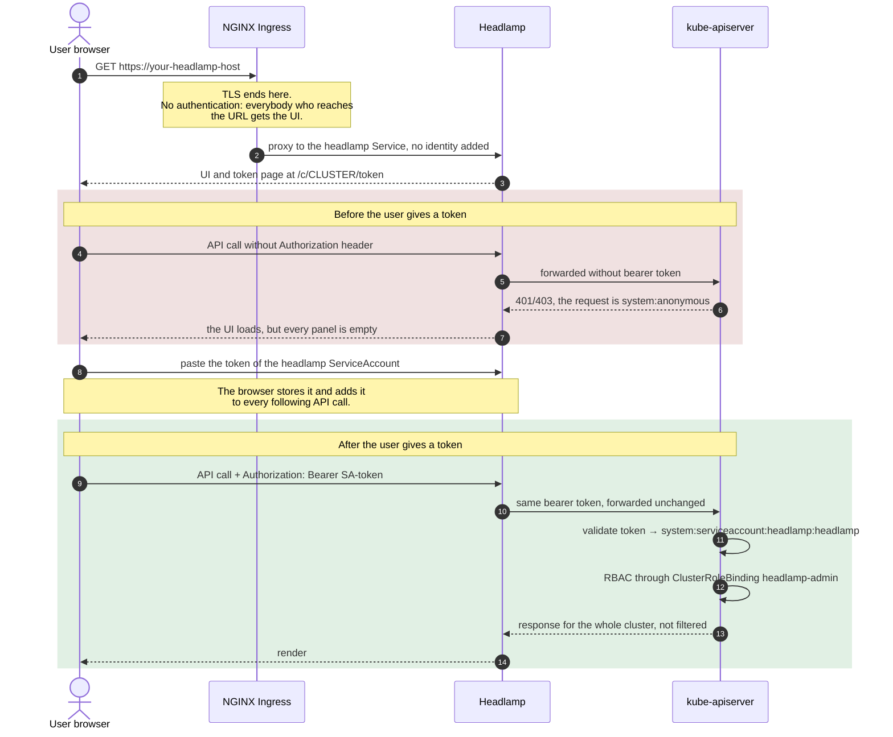
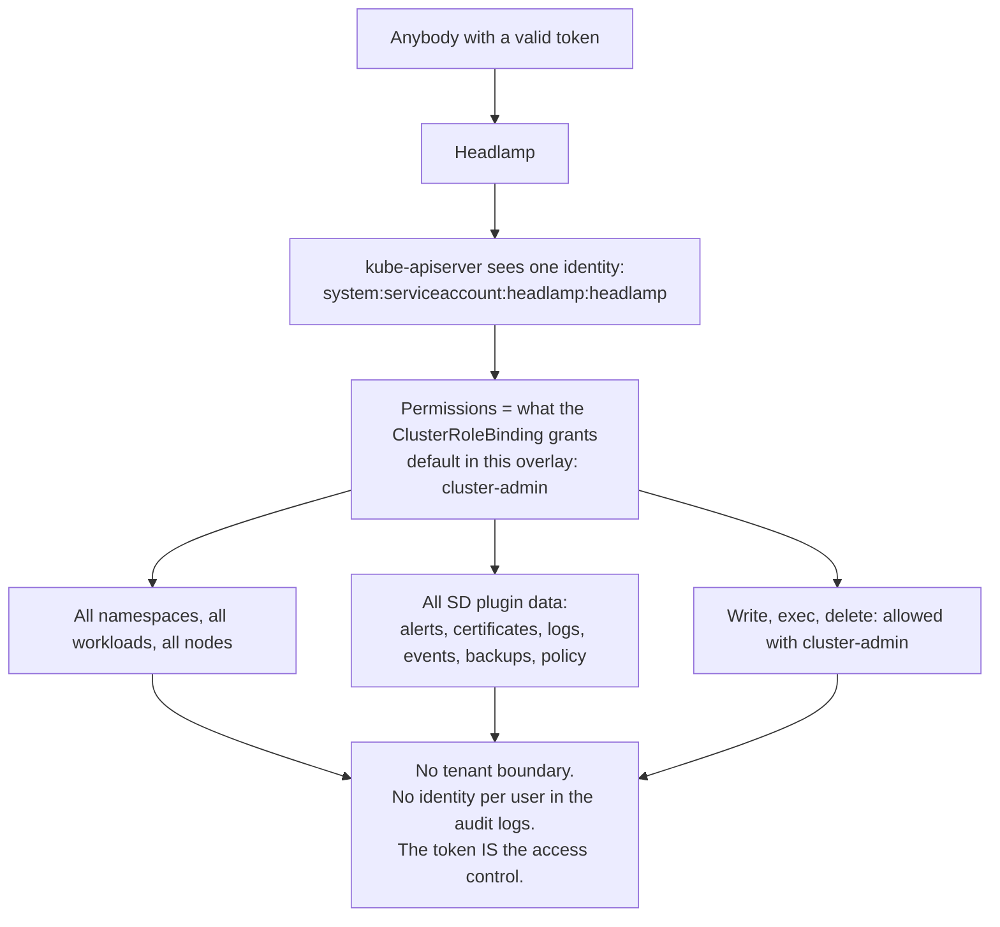

# Example: Headlamp with Kubernetes token login

<!-- <SD-DOCS> -->

This is the simplest way to expose Headlamp: **no SSO and no authentication on the
Ingress**. Headlamp runs `-in-cluster` and the Ingress serves it over TLS. The access is
protected by the **Kubernetes token login of Headlamp**. Headlamp sends the bearer token of
the user to the kube-apiserver with every request. Without a valid token, the API server sees
every request as `system:anonymous` and denies it: the UI loads, but it shows no data.

The user can log in with any valid Kubernetes token, for example the token of the `headlamp`
ServiceAccount. In this example the `ClusterRoleBinding` gives permissions on the whole
cluster to that ServiceAccount.

With the ServiceAccount token there is no identity per user and no tenant isolation:
everybody who has the token gets the permissions of the `ClusterRoleBinding`. Use this
example for clusters with a single administrator, for demos, or where there is no SSO or
OIDC provider. For SSO with a separate identity for each user, use
[`oidc-rbac`](../oidc-rbac) or [`oidc-capsule`](../oidc-capsule).

## At a glance

| | |
| --- | --- |
| **Entry point** | NGINX Ingress with TLS, **no authentication on the Ingress** |
| **Login** | The token page of Headlamp: the user pastes a Kubernetes bearer token |
| **Identity at the API server** | The owner of the token. With the ServiceAccount token, `system:serviceaccount:headlamp:headlamp` for everybody |
| **Who authorizes** | kube-apiserver RBAC. For the ServiceAccount token, the `ClusterRoleBinding` of this overlay |
| **Tenant isolation** | **None** |
| **Audit trail per user** | **None** with the ServiceAccount token: the logs show the ServiceAccount for every action |
| **Extra components required** | None (no Pomerium, no Dex, no Capsule) |
| **Good for** | Clusters with a single administrator, demos, environments without an identity provider |

## On SIGHUP Distribution

From SD v1.36.0, on **OnPremises** and **Immutable** clusters, the distribution renders this
example for you when you set the Headlamp type to `token-auth`:

```yaml
spec:
  distribution:
    modules:
      utilities:
        headlamp:
          type: token-auth
          clusterRole: view   # optional
```

There are some differences from this example:

| This example | What the distribution does |
| --- | --- |
| `ClusterRoleBinding` to `cluster-admin`, always created | It creates the binding **only** when you set `clusterRole`, and it binds the ClusterRole that you set. Without `clusterRole`, the `headlamp` ServiceAccount has no permissions, and the users log in with **their own** Kubernetes token, for example the token of their kubeconfig. Each user then has the permissions of their own token |
| Host `headlamp.example.com`, issuer `example-issuer` | It creates the Ingress at `dashboard.<baseDomain>`, with the ingress class and the TLS settings of the cluster |
| No pod placement | It schedules Headlamp on the infra nodes, like the other modules |

The utilities module is not available on the `EKSCluster` and `KFDDistribution` kinds. On
those kinds, or on a cluster that is not SD, apply this example by hand as described below.

## Authentication flow



## Capabilities and multitenancy

With the ServiceAccount token, the single `ClusterRoleBinding` decides everything that the
user can do. There is no other filter in the path.



What a user who logs in with the ServiceAccount token gets:

| Area | Behaviour |
| --- | --- |
| Namespaces / workloads / nodes | Everything in the cluster |
| sd-core landing page | Full: distribution data, node tiles, useful links |
| sd-alerts, sd-certificates | Full (Prometheus through `services/proxy`) |
| sd-events, sd-logs | Full, for the whole cluster (Loki or OpenSearch through `services/proxy`) |
| sd-backups, sd-policy | Full, for the whole cluster |
| Changes (scale, delete, exec, port forward) | Allowed with `cluster-admin`. To block them, bind a read only ClusterRole (for example `view`). Note that `view` does not include `services/proxy` and the `furyctl-*` Secrets, so some plugins are empty |
| Multitenancy | **Not supported.** Two people with two different ServiceAccount tokens still act as the same ServiceAccount |

## Cluster prerequisites

- A Kubernetes cluster with an **NGINX Ingress Controller** (this overlay uses
  `ingressClassName: nginx`).
- TLS for the Ingress host: a cert-manager **`ClusterIssuer`** (set in the Ingress
  annotation) or a TLS Secret that you create.

## What this overlay adds to the base `headlamp` package

This overlay starts from the base package (`../../katalog/headlamp`) and adds:

| Resource | Purpose |
| --- | --- |
| `ClusterRoleBinding` (`clusterrolebinding.yaml`) | Binds the `headlamp` ServiceAccount to `cluster-admin`. Use `view` (or your own ClusterRole) to give fewer permissions |
| `Ingress` (`ingress.yaml`) | TLS, sent to the `headlamp` Service (no authentication annotations) |

You do not need to patch the Deployment: the base already runs `-in-cluster` against
`kubernetes.default.svc`, and this is what this model needs.

## What you must provide

This table lists all the inputs of this overlay. The last column says where the same value
is on a SIGHUP Distribution cluster. The distribution field names were checked against
**SD v1.36.0**.

| # | Input | Where you set it | Example | On a SIGHUP Distribution cluster |
| --- | --- | --- | --- | --- |
| 1 | **Headlamp hostname** | `ingress.yaml` → `spec.rules[0].host` **and** `spec.tls[0].hosts[0]` | `headlamp.example.com` | always `dashboard.<spec.distribution.modules.ingress.baseDomain>` |
| 2 | **Ingress class** | `ingress.yaml` → `spec.ingressClassName` | `nginx` | taken from `spec.distribution.modules.ingress` |
| 3 | **TLS source** | `ingress.yaml` → the `cert-manager.io/cluster-issuer` annotation (placeholder `example-issuer`). As an alternative, remove it and create the Secret named in `spec.tls[0].secretName` yourself | `letsencrypt-prod` | taken from `spec.distribution.modules.ingress` (TLS provider, `certManager.clusterIssuer.name`) |
| 4 | **ClusterRole to bind** | `clusterrolebinding.yaml` → `roleRef.name` | `cluster-admin` (default) or `view` | `spec.distribution.modules.utilities.headlamp.clusterRole` (optional, no binding when it is not set) |
| 5 | **Image tag** (optional) | `../../katalog/headlamp/kustomization.yaml` → `images:` transformer | `registry.sighup.io/fury/sd-ui:<tag>` | set by the distribution version |

You need nothing else: this model has **no** OIDC issuer, audience, group, Capsule or CA
inputs.

## Deploy

From the root of the repository:

```shell
kustomize build examples/token-auth | kubectl apply -f -
```

## Logging in

The URL opens Headlamp on its **token page** (`/c/<cluster>/token`). Headlamp sends the
token that you give to the kube-apiserver with every request (without a token, the requests
are `system:anonymous` and the API server denies them). You can use the token of the
`headlamp` ServiceAccount, which has the permissions of the `ClusterRoleBinding`:

```shell
kubectl create token headlamp -n headlamp --duration=24h
```

## Security notes

- **The token is the access control.** The Ingress has no authentication, so everybody who
  reaches the URL sees the token page. Without a valid Kubernetes token, they cannot do
  anything.
- **One shared identity, no audit trail.** Everybody who uses the ServiceAccount token acts
  as the same ServiceAccount. There is no identity per user and no tenant filtering. Handle
  the token as a shared credential: give it fewer permissions (bind `view` instead of
  `cluster-admin` when you can) and change it often. For access with a separate identity for
  each user, use [`oidc-rbac`](../oidc-rbac) or [`oidc-capsule`](../oidc-capsule).
- The Ingress has no authentication, so limit the network access to the host.

## Choosing another model

| You need | Use |
| --- | --- |
| SSO with an identity for each user, and one view of the whole cluster for the operations team | [`oidc-rbac`](../oidc-rbac) |
| SSO with an identity for each user **and** isolation of the namespaces of each tenant | [`oidc-capsule`](../oidc-capsule) |

<!-- </SD-DOCS> -->

## License

This package is governed by a BSD-style license. See the [LICENSE](../../LICENSE) file.
