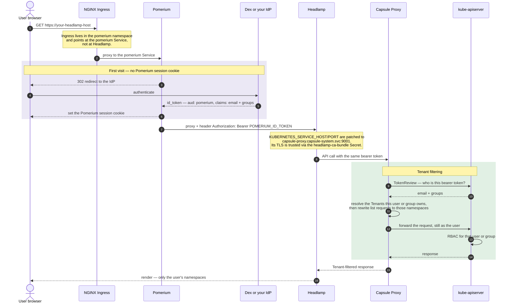
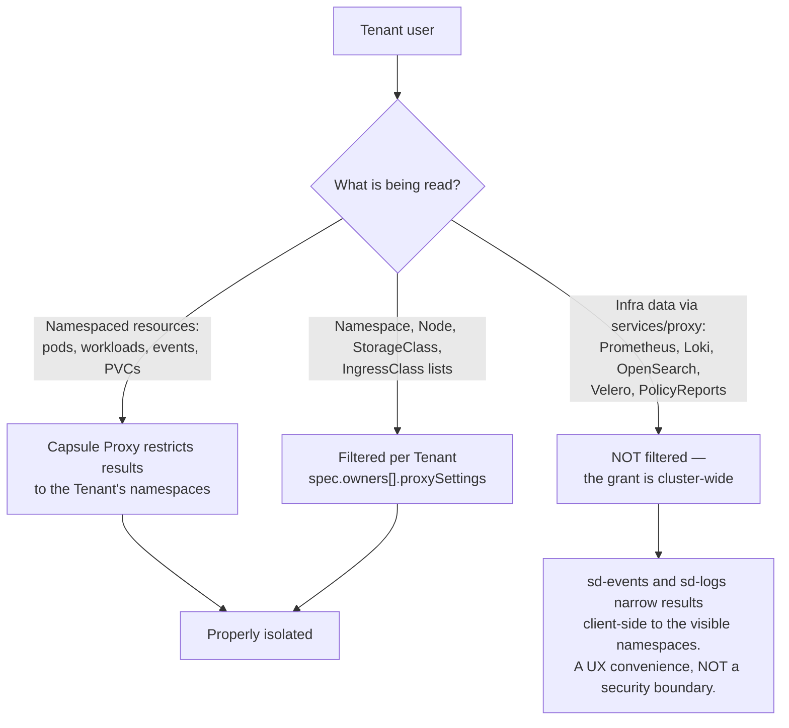

# Example: Headlamp behind an SSO proxy (Pomerium) + Capsule multi-tenancy

<!-- <SD-DOCS> -->

Headlamp behind an identity-aware **SSO proxy** (Pomerium), with API requests proxied
through **Capsule Proxy** for per-tenant isolation. There is one identity end-to-end — the
user's OIDC `id_token` — and each user sees only the namespaces their Capsule Tenant allows.

Headlamp itself runs in token-passthrough mode (no `-oidc-*` flags) — the proxy owns the
login and supplies the token.

## At a glance

| | |
|---|---|
| **Front door** | NGINX Ingress → **Pomerium** (the Ingress lives in the `pomerium` namespace) |
| **Login** | Full OIDC redirect flow to your IdP (Dex on a stock SD cluster) |
| **Identity at the API server** | The **real user** — `email` claim as username, `groups` claim as groups |
| **Who authorizes** | Capsule Proxy (tenant filtering) **and** kube-apiserver RBAC |
| **Tenant isolation** | **Yes, for namespaced resources** — see the two-lane diagram below |
| **Per-user audit trail** | **Yes** — API server audit logs show the user's email |
| **Extra components required** | Pomerium + an OIDC IdP; **Capsule + Capsule Proxy**; kube-apiserver configured to trust the IdP |
| **Good for** | Multi-team clusters where each team must only see its own namespaces |

## Authentication flow



Two independent checks apply to every request: Capsule Proxy narrows *which objects* come
back, and the API server's RBAC decides *whether the user may read them at all*. A user needs
both.

## Capabilities and multitenancy

Isolation is **not uniform** — it depends on what is being read. This is the single most
important thing to understand about this model:



What a tenant user gets:

| Area | Isolated? | Behaviour |
|---|---|---|
| Pods, workloads, events, PVCs inside namespaces | **Yes** | Capsule Proxy returns only the Tenant's namespaces |
| Namespace list | **Yes** | Only the Tenant's namespaces |
| Node list and node CPU/memory tiles | **Yes**, via Capsule | Requires `Nodes: List` in the Tenant's `proxySettings`. Metrics are served by Capsule Proxy's own ServiceAccount, so tenant users need **no** `nodes` or `metrics.k8s.io` grant |
| sd-core landing page | Partly | Distribution metadata comes from the `furyctl-*` secrets in `kube-system` — a cluster-level read granted to all tenant users |
| sd-alerts, sd-certificates | **No** | Prometheus is queried cluster-wide |
| sd-events, sd-logs | **Client-side only** | The backend query is cluster-wide; the UI filters to visible namespaces |
| sd-backups, sd-policy | **No** | All Velero backups and all PolicyReports in the cluster are listed |
| Mutating actions | Per RBAC | Capsule scopes *where*; your RBAC decides *whether*. The RBAC below is read-only |

If cross-tenant visibility of monitoring/backup/policy data is unacceptable, this example is
not sufficient on its own — you would need per-tenant-scoped backends or an authorizing proxy
in front of each datasource (out of scope here, and would require plugin changes for the
cluster-scoped resources).

## What this overlay adds to the base `headlamp` package

This overlay layers on top of the base package (`../../katalog/headlamp`):

| Resource | Purpose |
|---|---|
| Deployment patch (`patch-deployment.yaml`) | Points Headlamp at Capsule Proxy (`capsule-proxy.capsule-system.svc:9001`) and mounts a projected ServiceAccount token + the `headlamp-ca-bundle` CA so it trusts Capsule Proxy's TLS. |
| `Ingress` (`ingress.yaml`, namespace `pomerium`) | Routes the Headlamp hostname to the **Pomerium** Service (not to Headlamp directly). |

## Cluster prerequisites (desired state)

This overlay ships **only the Headlamp side**. Before applying, the cluster must already
provide the following:

1. **An SSO proxy (Pomerium) backed by an OIDC provider.** Pomerium must be installed and
   reachable, backed by an OIDC identity provider (e.g. Dex), and configured with a **route
   for the Headlamp host** that proxies to the Headlamp Service and injects the user's token.

   **Where to add the route:** in the Pomerium route configuration your instance loads —
   the `routes` (or `policy`) list in Pomerium's config `ConfigMap`/`Secret` in the
   `pomerium` namespace. If Pomerium is managed by an umbrella config that renders it, edit
   it there instead and re-apply (do **not** hand-edit the rendered object, it will be
   overwritten): on a **SIGHUP Distribution** cluster this is the
   `spec.distribution.modules.auth.pomerium.routes` list of the distribution configuration
   (a list of route objects). The older `…auth.pomerium.policy` string field still works but
   is **deprecated** — `routes` plus `defaultRoutesPolicy` replace it.

   The route to add:

   ```yaml
   # <YOUR_HEADLAMP_HOST> must equal the ingress host set below
   - from: https://<YOUR_HEADLAMP_HOST>
     to: http://headlamp.headlamp.svc.cluster.local:80
     set_request_headers:
       Authorization: "Bearer ${pomerium.id_token}"   # Pomerium substitutes the user's id_token
     allow_websockets: true        # required for exec/logs streaming
     preserve_host_header: true
     policy:
       - allow:
           and:
             - authenticated_user: true
   ```

2. **Capsule + Capsule Proxy** installed for multi-tenant filtering. This overlay assumes
   the proxy is reachable at `capsule-proxy.capsule-system.svc:9001` — adjust
   `patch-deployment.yaml` if yours differs.

   Capsule is **not** part of the SIGHUP Distribution core: on an SD cluster it is installed
   as a furyctl plugin (a `plugins.helm` release of the `projectcapsule/capsule` chart with
   `proxy.enabled: true`). See `furyctl/plugins/helm/capsule/values.yaml` in this repo for a
   working values file.

3. **The kube-apiserver configured to accept the OIDC tokens** — i.e. it trusts the OIDC
   issuer and accepts the audience the proxy's tokens carry (commonly `pomerium`), with the
   `email` claim mapped to the username and the `groups` claim to groups (Capsule keys
   tenants off the group). See item 5 in
   [What you must provide](#what-you-must-provide) for the audience caveat.

4. **At least one Capsule `Tenant`** whose `spec.owners` match your users or groups, and
   whose `proxySettings` allow listing nodes (otherwise the sd-core node tiles stay empty):

   ```yaml
   apiVersion: capsule.clastix.io/v1beta2
   kind: Tenant
   metadata:
     name: <tenant-name>
   spec:
     owners:
       - name: <user-email-or-group>
         kind: User        # or Group
         proxySettings:
           - kind: Nodes
             operations: [List]          # sd-core node tiles
           - kind: StorageClasses
             operations: [List]
           - kind: IngressClasses
             operations: [List]
   ```

5. **The `headlamp-ca-bundle` Secret** in the `headlamp` namespace — so Headlamp trusts
   Capsule Proxy's TLS. It must hold, under key `ca.crt`, the CA that signs Capsule Proxy's
   serving certificate:

   ```shell
   kubectl create namespace headlamp --dry-run=client -o yaml | kubectl apply -f -
   # Capsule Proxy publishes its CA in the capsule-system/capsule-proxy secret (key: ca):
   kubectl get secret capsule-proxy -n capsule-system -o jsonpath='{.data.ca}' \
     | base64 -d > /tmp/capsule-ca.crt
   kubectl create secret generic headlamp-ca-bundle -n headlamp \
     --from-file=ca.crt=/tmp/capsule-ca.crt \
     --dry-run=client -o yaml | kubectl apply -f -
   ```

## What you must provide

Everything this overlay needs from you. The last column records where the same value already
lives on a SIGHUP Distribution cluster — useful when wiring this into the distribution.
Distribution field names were checked against **SD v1.35.1**. This model has the largest
input surface of the three examples.

| # | Input | Where you set it | Example | On a SIGHUP Distribution cluster |
|---|---|---|---|---|
| 1 | **Headlamp hostname** | `ingress.yaml` → `spec.rules[0].host`, the `cluster.kfd.sighup.io/useful-link.url` annotation **and** `spec.tls[0].hosts[0]`. Must equal the Pomerium route's `from:` host | `headlamp.example.com` | derivable from `spec.distribution.modules.ingress.baseDomain` |
| 2 | **Ingress class / TLS source** | `ingress.yaml` → `spec.ingressClassName`; annotation `cert-manager.io/cluster-issuer` (placeholder `kind-ca`), or pre-create the Secret in `spec.tls[0].secretName` | `nginx` / `letsencrypt-prod` | `spec.distribution.modules.ingress.nginx.type`, `…ingress.certManager.clusterIssuer.name` |
| 3 | **Pomerium route for the Headlamp host** | Pomerium's own route configuration (prerequisite 1) — **not** in this overlay | see prerequisite 1 | `spec.distribution.modules.auth.pomerium.routes` (`…pomerium.policy` is deprecated) |
| 4 | **Capsule Proxy endpoint** — the address Headlamp uses *instead of* the API server | `patch-deployment.yaml` → env `KUBERNETES_SERVICE_HOST` and `KUBERNETES_SERVICE_PORT` | `capsule-proxy.capsule-system.svc` / `9001` | **new input** — no distribution field exists today |
| 5 | **kube-apiserver OIDC trust**: issuer URL, accepted audience (`pomerium`), issuer CA, and the `email`/`groups` claim mappings | The API server's configuration — either `--oidc-*` flags or a structured `AuthenticationConfiguration` | issuer `https://login.example.com`, audience `pomerium`, `username_claim: email`, `groups_claim: groups` | **onpremises**: `spec.kubernetes.advanced.oidc.{issuer_url, client_id, ca_file, username_claim, groups_claim}`. **kfddistribution**: the spec has no `kubernetes` section at all — the cluster is yours. **EKS**: no furyctl field; use an EKS OIDC identity provider association. See the caveat below |
| 6 | **Capsule Proxy CA** → the `headlamp-ca-bundle` Secret in the `headlamp` namespace, key `ca.crt` | Created out-of-band (prerequisite 5); consumed by the projected volume in `patch-deployment.yaml` | CA from `capsule-system/capsule-proxy`, key `ca` | **new input** — must be created and kept in sync when Capsule Proxy's cert rotates |
| 7 | **Capsule `Tenant` definitions**: owners and `proxySettings` | Cluster resources you author (prerequisite 4) | `Nodes: List` for the sd-core node tiles | **new input** — Capsule is a furyctl plugin, not a distribution module |
| 8 | **Tenant group for RBAC** | The `<YOUR_TENANT_GROUP>` in the RBAC bundle below | `capsule.clastix.io` | must be one of the Capsule chart's `manager.options.capsuleUserGroups` (default: `capsule.clastix.io` and `oidc:capsule.clastix.io`) **and** present in the user's `groups` claim |
| 9 | **Observability backend Service names** | The `services/proxy` `resourceNames` in the RBAC bundle. Both the bare and port-suffixed forms are required | `loki-stack`, `loki-stack:3100` | defaults match the SD module Services; adjust if you override them |
| 10 | **Image tag** (optional) | `../../katalog/headlamp/kustomization.yaml` → `images:` transformer | `registry.sighup.io/fury/sd-ui:<tag>` | pinned by the distribution version |

### Caveat on item 5 — audiences

The legacy `--oidc-client-id` flag (what `spec.kubernetes.advanced.oidc.client_id` renders to
on onpremises clusters) accepts **exactly one audience**. Setting it to `pomerium` makes
`pomerium` the *only* accepted audience, which breaks any other OIDC client on the cluster
(for example Gangplank issuing kubeconfigs, which uses its own client ID).

Accepting several audiences requires a structured `AuthenticationConfiguration`
(`apiserver.config.k8s.io/v1`) with `audiences: [...]` and
`audienceMatchPolicy: MatchAny`, passed to the API server via `--authentication-config`.
furyctl does not template that file today. This repo's dev environment does it by hand and
mounts it into the Kind control plane — see `dev/auth-config.yaml.tpl` for a working
reference. **This is the main open question for integrating the UI into the distribution.**

## RBAC for tenant users (to use all UI features)

Capsule Proxy scopes **namespaced** resources (pods, workloads, events in the tenant's
namespaces) to the Tenant automatically. But most SD plugins also read **cluster-scoped or
cross-namespace** data (config secrets, infra service proxies, cluster-scoped reports). A
tenant user gets none of that from Capsule alone — grant it explicitly to the group your
OIDC `groups` claim maps to (with Capsule, users are members of `capsule.clastix.io`).

The minimal grants for full UI functionality — bind to `<YOUR_TENANT_GROUP>`:

```yaml
# Namespaced: read the SD config secrets (module detection / sd-core landing page)
apiVersion: rbac.authorization.k8s.io/v1
kind: Role
metadata:
  name: sd-ui-config-reader
  namespace: kube-system
rules:
  - apiGroups: [""]
    resources: ["secrets"]
    resourceNames: ["furyctl-kfd", "furyctl-config"]
    verbs: ["get"]
---
apiVersion: rbac.authorization.k8s.io/v1
kind: ClusterRole
metadata:
  name: sd-ui-reader
rules:
  - apiGroups: ["networking.k8s.io"]     # sd-core "useful links"
    resources: ["ingresses"]
    verbs: ["get"]
  - apiGroups: [""]                        # sd-alerts, sd-certificates, sd-core (Prometheus)
    resources: ["services/proxy"]
    resourceNames: ["prometheus-k8s", "prometheus-k8s:9090"]
    verbs: ["get", "create"]              # create = POST-style proxy calls (e.g. query_range)
  - apiGroups: [""]                        # sd-events, sd-logs (Loki and/or OpenSearch)
    resources: ["services/proxy"]
    resourceNames: ["loki-stack", "loki-stack:3100", "opensearch-cluster-master", "opensearch-cluster-master:9200"]
    verbs: ["get", "create"]
  - apiGroups: ["velero.io"]               # sd-backups
    resources: ["backups", "schedules", "restores"]
    verbs: ["get", "list"]
  - apiGroups: ["wgpolicyk8s.io"]          # sd-policy (Kyverno)
    resources: ["policyreports", "clusterpolicyreports"]
    verbs: ["get", "list"]
  - apiGroups: ["constraints.gatekeeper.sh"]   # sd-policy (Gatekeeper); constraint kinds
    resources: ["*"]                           # are dynamic CRDs, so the wildcard is required
    verbs: ["get", "list"]
# + a RoleBinding (kube-system) and a ClusterRoleBinding tying <YOUR_TENANT_GROUP> to the
#   Role and ClusterRole above.
```

Only include the rules for modules you actually run (e.g. drop the OpenSearch names if you
use Loki, or the Gatekeeper rule if you use Kyverno).

**Nodes and node metrics are handled by Capsule, not this RBAC.** The sd-core overview lists
nodes via the Capsule **Tenant `proxySettings`** (`Nodes: List`), and node CPU/memory metrics
(`metrics.k8s.io`) are served by **Capsule Proxy's own ServiceAccount** — so tenant users need
**no** explicit `nodes` or `metrics.k8s.io` grant for those tiles to work.

### Cluster-scoped resources & client-side filtering (important)

Several of the reads above are inherently **cluster-wide** — node/cluster-policy reports,
Gatekeeper constraints, and the Prometheus/Loki/OpenSearch/Velero endpoints live in infra
namespaces, not the tenant's. The grants are therefore **not filtered per tenant**, with two
consequences to be aware of:

- A tenant user can query **all** metrics and logs, and list **all** Velero backups and
  **all** PolicyReports across the cluster — not only their own namespaces.
- The UI narrows some of this **client-side only**: sd-events and sd-logs filter results to
  the namespaces returned by the (Capsule-filtered) namespace list, but the underlying proxy
  grant still permits querying everything. **Client-side filtering is a UX convenience, not a
  security boundary.** Namespaced resources (pods, workloads, events *inside* tenant
  namespaces) remain properly isolated by Capsule Proxy.

## Logout

Headlamp's own logout does nothing behind an SSO proxy, so `sd-core` hides it and shows a
sign-out button that navigates to:

```
/.pomerium/sign_out?pomerium_redirect_uri=https://headlamp.<base-domain>/
```

Pomerium revokes the session and then sends the browser back to Headlamp, where — with no
session left — it restarts the OIDC flow and the user lands on the Dex login form. Without
the `pomerium_redirect_uri` the user would instead end up on Pomerium's built-in
"signed out" page.

Two things to check when **not** using Dex:

- If the IdP advertises `end_session_endpoint` in its discovery document, Pomerium forwards
  that URL as `post_logout_redirect_uri`. Most IdPs reject or ignore a value that is not
  pre-registered on the client — register `https://headlamp.<base-domain>/` there. Dex does
  not advertise the endpoint, so this does not apply on a stock SD cluster.
- If the IdP keeps its own SSO cookie, it will silently re-authenticate the user on the way
  back and logout will look like it did nothing. That is a property of the IdP, not of this
  overlay. Dex has no browser session for password/LDAP connectors, so it re-prompts.

## Placeholders to set before applying

- **Hostname.** In `ingress.yaml`, replace `headlamp.example.com` in the rule host, the
  `cluster.kfd.sighup.io/useful-link.url` annotation, and `tls.hosts`. It must match the
  Pomerium route's `from:` host (prerequisite 1).
- **TLS issuer.** The ingress is annotated `cert-manager.io/cluster-issuer: kind-ca`
  (a placeholder). Point it at your `ClusterIssuer`, or remove it and supply your own TLS
  Secret named in `tls.secretName`.
- **Capsule Proxy address.** Only if it differs from the default assumed in
  `patch-deployment.yaml`.
- **Image (optional).** Pin a build via the `images:` transformer in
  `../../katalog/headlamp/kustomization.yaml`.

## Deploy

From this directory:

```shell
kustomize build . | kubectl apply -f -
```

## Verify

Open `https://<your-host>` → you are redirected to the OIDC provider to log in. After login,
Headlamp shows **only the namespaces in your Capsule Tenant**. A user with a cluster-wide
binding sees everything.

Troubleshooting the usual failures:

| Symptom | Likely cause |
|---|---|
| Headlamp pod logs show `x509: certificate signed by unknown authority` | The `headlamp-ca-bundle` Secret is missing or holds the wrong CA (item 6) |
| Login succeeds but every page is empty | The API server rejects the token — wrong issuer, audience or CA (item 5) |
| Logged in, but no namespaces are listed | No Capsule `Tenant` lists this user or group as an owner (item 7) |
| Namespaces appear but node tiles are empty | The Tenant is missing `proxySettings` `Nodes: List` (item 7) |
| Everything works except alerts, logs or events | Missing `services/proxy` grants, or the port-suffixed `resourceNames` (item 9) |

<!-- </SD-DOCS> -->
