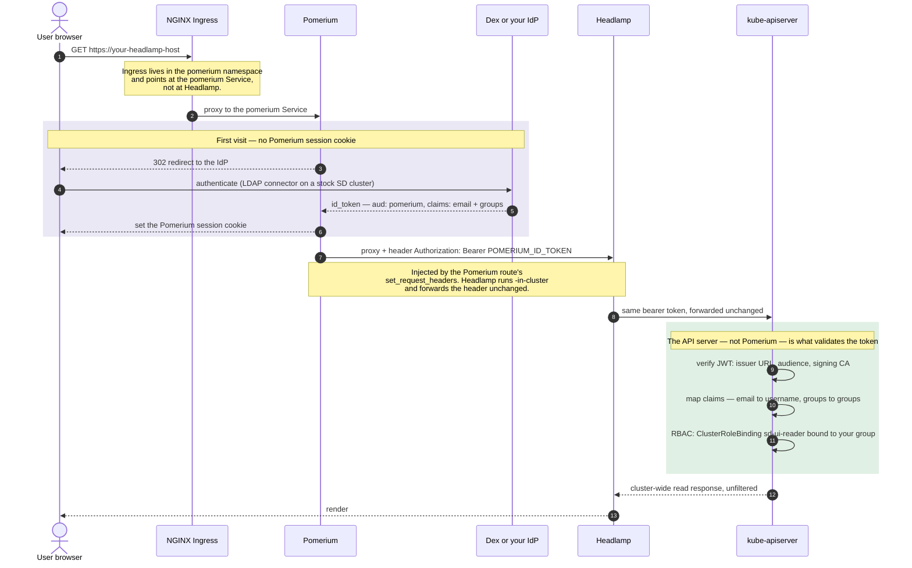
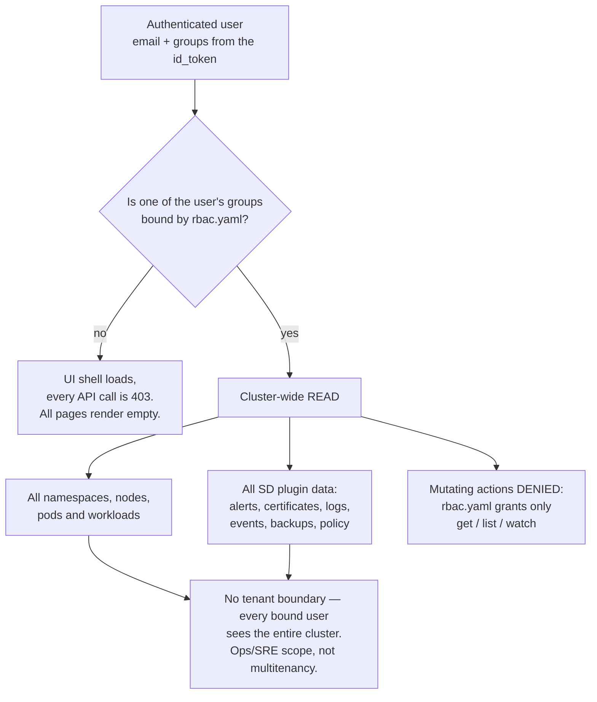

# oidc-rbac — Headlamp behind SSO, per-user RBAC, **no Capsule**

<!-- <SD-DOCS> -->

This overlay fronts Headlamp with **Pomerium SSO** and lets each user reach the Kubernetes
API server **as themselves**, with plain Kubernetes RBAC deciding what they can see — with
**no Capsule** in the cluster.

It is the middle ground between the other two overlays:

- [`token-auth`](../token-auth) — one shared ServiceAccount identity, raw-token login. Simple
  but not per-user, and the token login is awkward for non-technical users.
- [`oidc-capsule`](../oidc-capsule) — SSO **with** Capsule Proxy for per-tenant isolation.
- **`oidc-rbac` (this one)** — SSO **without** Capsule; per-user/-group RBAC, but no
  tenant isolation (see the scope note below).

## At a glance

| | |
|---|---|
| **Front door** | NGINX Ingress → **Pomerium** (the Ingress lives in the `pomerium` namespace) |
| **Login** | Full OIDC redirect flow to your IdP (Dex on a stock SD cluster) |
| **Identity at the API server** | The **real user** — `email` claim as username, `groups` claim as groups |
| **Who authorizes** | kube-apiserver RBAC, bound to an OIDC **group** you choose |
| **Tenant isolation** | **None** — bound users get cluster-wide read |
| **Per-user audit trail** | **Yes** — API server audit logs show the user's email |
| **Extra components required** | Pomerium + an OIDC IdP; kube-apiserver configured to trust that IdP |
| **Good for** | Ops/SRE teams who should all see the whole cluster, with named identities |

## Authentication flow



The base Deployment already runs `-in-cluster` against the real API server, so **no
deployment patch is required** — this overlay adds only the Ingress (front door) and the
RBAC bundle. Capsule Proxy is simply absent from the path, which is fine: the API server
(not Capsule) is what validates the token in every model.

## Capabilities and multitenancy



What a bound user gets:

| Area | Behaviour |
|---|---|
| Namespaces / workloads / nodes | **Everything in the cluster** |
| sd-core landing page | Full — including node CPU/memory tiles (`metrics.k8s.io` is granted in `rbac.yaml`) |
| sd-alerts, sd-certificates | Full (Prometheus via `services/proxy`) |
| sd-events, sd-logs | Full, cluster-wide (Loki and/or OpenSearch via `services/proxy`) |
| sd-backups, sd-policy | Full, cluster-wide |
| Mutating actions (scale, delete, exec, port-forward) | **Denied** — the bundled RBAC is read-only. Extend `rbac.yaml` deliberately if you want them |
| Per-user identity | **Yes** — every request is attributed to the user's email |
| Multitenancy | **Not supported** — see *Scope* below |

## Requirements

- `auth.provider.type: sso` — Pomerium + Dex present.
- **The kube-apiserver must trust your OIDC issuer and accept the audience Pomerium
  forwards.** Pomerium mints an id_token with `aud: pomerium`, so `pomerium` must be an
  accepted audience. How you configure that depends on the cluster — see
  [What you must provide](#what-you-must-provide), item 4.
- A Pomerium route for the Headlamp host that injects the bearer token, e.g.:

  ```yaml
  - from: https://headlamp.<base-domain>
    to: http://headlamp.headlamp.svc.cluster.local:80
    set_request_headers:
      Authorization: "Bearer ${pomerium.id_token}"
    allow_websockets: true
    preserve_host_header: true
    policy:
      - allow:
          and:
            - authenticated_user: true
  ```

  `allow_websockets: true` is required for log streaming and `exec`.

## What you must provide

Everything this overlay needs from you. The last column records where the same value already
lives on a SIGHUP Distribution cluster — useful when wiring this into the distribution.
Distribution field names were checked against **SD v1.35.1**.

| # | Input | Where you set it | Example | On a SIGHUP Distribution cluster |
|---|---|---|---|---|
| 1 | **Headlamp hostname** | `ingress.yaml` → `spec.rules[0].host`, the `cluster.kfd.sighup.io/useful-link.url` annotation **and** `spec.tls[0].hosts[0]`. Must equal the Pomerium route's `from:` host | `headlamp.example.com` | derivable from `spec.distribution.modules.ingress.baseDomain` |
| 2 | **Ingress class / TLS source** | `ingress.yaml` → `spec.ingressClassName`; annotation `cert-manager.io/cluster-issuer` (placeholder `kind-ca`), or pre-create the Secret in `spec.tls[0].secretName` | `nginx` / `letsencrypt-prod` | `spec.distribution.modules.ingress.nginx.type`, `…ingress.certManager.clusterIssuer.name` |
| 3 | **Pomerium route for the Headlamp host** | Pomerium's own route configuration (see the snippet above) — **not** in this overlay | see above | `spec.distribution.modules.auth.pomerium.routes` (`…pomerium.policy` is deprecated) |
| 4 | **kube-apiserver OIDC trust**: issuer URL, accepted audience (`pomerium`), issuer CA, and the `email`/`groups` claim mappings | The API server's configuration — either `--oidc-*` flags or a structured `AuthenticationConfiguration` file | issuer `https://login.example.com`, audience `pomerium`, `username_claim: email`, `groups_claim: groups` | **onpremises**: `spec.kubernetes.advanced.oidc.{issuer_url, client_id, ca_file, username_claim, groups_claim}`. **kfddistribution**: the spec has no `kubernetes` section at all — the cluster is yours. **EKS**: no furyctl field; use an EKS OIDC identity provider association. See the caveat below |
| 5 | **OIDC group to grant** | `rbac.yaml` → replace **every** `sd-ui-viewers` placeholder (3 occurrences: two `ClusterRoleBinding`s and one `RoleBinding`) | an LDAP group CN your Dex connector emits | groups come from the connector in `spec.distribution.modules.auth.dex.connectors` |
| 6 | **Observability backend Service names** | `rbac.yaml` → `services/proxy` `resourceNames`. Both the bare and port-suffixed forms are required | `loki-stack`, `loki-stack:3100` | defaults match the SD module Services; adjust if you override them |
| 7 | **Image tag** (optional) | `../../katalog/headlamp/kustomization.yaml` → `images:` transformer | `registry.sighup.io/fury/sd-ui:<tag>` | pinned by the distribution version |

### Caveat on item 4 — audiences

The legacy `--oidc-client-id` flag (what `spec.kubernetes.advanced.oidc.client_id` renders to
on onpremises clusters) accepts **exactly one audience**. If you set it to `pomerium`, then
`pomerium` is the *only* accepted audience — any other OIDC client on the cluster (for
example Gangplank issuing kubeconfigs, which uses its own client ID) will stop being accepted
by the API server.

Accepting several audiences requires a structured `AuthenticationConfiguration`
(`apiserver.config.k8s.io/v1`) with `audiences: [...]` and
`audienceMatchPolicy: MatchAny`, passed to the API server via `--authentication-config`.
furyctl does not template that file today. This repo's dev environment does it by hand and
mounts it into the Kind control plane — see `dev/auth-config.yaml.tpl` for a working
reference:

```yaml
apiVersion: apiserver.config.k8s.io/v1
kind: AuthenticationConfiguration
jwt:
  - issuer:
      url: https://login.<base-domain>
      audiences: [pomerium, oidc-auth-client]
      audienceMatchPolicy: MatchAny
      certificateAuthority: |
        <PEM of the CA that signs the IdP's TLS cert>
    claimMappings:
      username: { claim: email, prefix: "" }
      groups:   { claim: groups, prefix: "" }
```

**This is the single biggest open question for integrating the UI into the distribution:**
either the distribution standardises on `pomerium` as the one API-server audience, or it
gains a way to render an `AuthenticationConfiguration`.

## RBAC

`rbac.yaml` binds the SD plugin read permissions to a **real OIDC group** carried in the
user's `groups` claim. Before applying, replace every `sd-ui-viewers` placeholder with a
group your Dex connector actually emits (e.g. an LDAP group CN). Do **not** use
`capsule.clastix.io` — that group only exists when Capsule Proxy is present.

The bundle grants, all read-only:

| Object | Scope | Grants |
|---|---|---|
| `ClusterRole/sd-ui-reader` | cluster | core resources, `metrics.k8s.io` nodes, `apps` workloads, ingresses, Kyverno `policyreports`/`clusterpolicyreports`, Gatekeeper constraints (`*`), Velero `backups`/`schedules`/`restores` |
| `ClusterRole/sd-ui-service-proxy` | cluster | `services/proxy` to Prometheus, Loki and OpenSearch — never covered by the built-in `view` role |
| `Role/sd-ui-furyctl-secrets-reader` | `kube-system` | `get` on the `furyctl-kfd` and `furyctl-config` secrets only (`view` excludes secrets) |

## Logout

Headlamp's own logout does nothing behind an SSO proxy, so `sd-core` hides it and shows a
sign-out button that navigates to:

```
/.pomerium/sign_out?pomerium_redirect_uri=https://headlamp.<base-domain>/
```

Pomerium revokes the session and then sends the browser back to Headlamp, where — with no
session left — it restarts the OIDC flow and the user lands on the Dex login form. Without
the `pomerium_redirect_uri` the user would instead end up on Pomerium's built-in
"signed out" page.

Two things to check when **not** using Dex:

- If the IdP advertises `end_session_endpoint` in its discovery document, Pomerium forwards
  that URL as `post_logout_redirect_uri`. Most IdPs reject or ignore a value that is not
  pre-registered on the client — register `https://headlamp.<base-domain>/` there. Dex does
  not advertise the endpoint, so this does not apply on a stock SD cluster.
- If the IdP keeps its own SSO cookie, it will silently re-authenticate the user on the way
  back and logout will look like it did nothing. That is a property of the IdP, not of this
  overlay. Dex has no browser session for password/LDAP connectors, so it re-prompts.

## Scope — READ THIS

Without Capsule Proxy there is no "list only the namespaces I'm allowed to see" primitive
in vanilla RBAC: a cluster-wide `list` (which sd-core, sd-events, sd-logs and sd-policy all
perform) either returns **everything** or is denied. This overlay therefore grants
**cluster-wide read** — every bound user sees the whole cluster. It is an **ops/SRE-scope**
model, **not** multi-tenant isolation. If you need per-team boundaries, use
[`oidc-capsule`](../oidc-capsule) instead.

## Deployment

```shell
# Edit the host in ingress.yaml and the group in rbac.yaml first.
kustomize build examples/oidc-rbac | kubectl apply -f -
```

## Verify

Open `https://<your-host>` → you are redirected to the IdP to log in. After login, Headlamp
shows the whole cluster. If pages render empty, the user's `groups` claim almost certainly
does not contain the group you bound in `rbac.yaml` — check with:

```shell
kubectl auth can-i list pods --all-namespaces --as=<user-email> --as-group=<your-group>
```

<!-- </SD-DOCS> -->

## License

This package is governed by a BSD-style license — see the repository for details.
