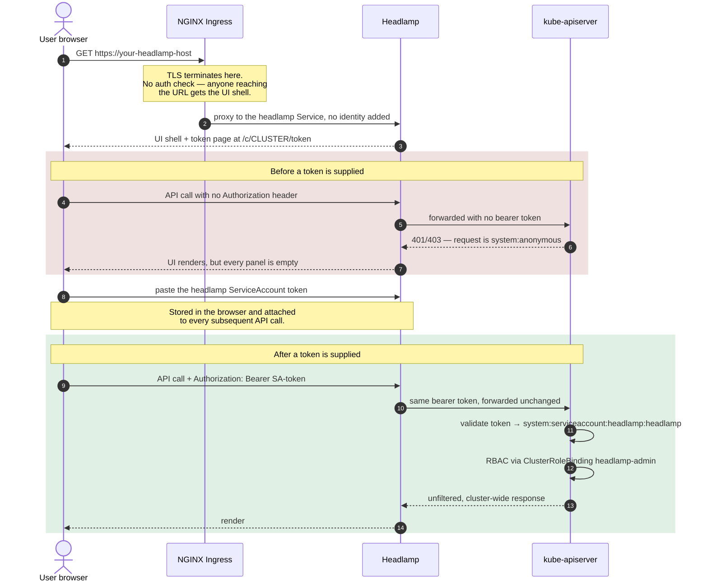
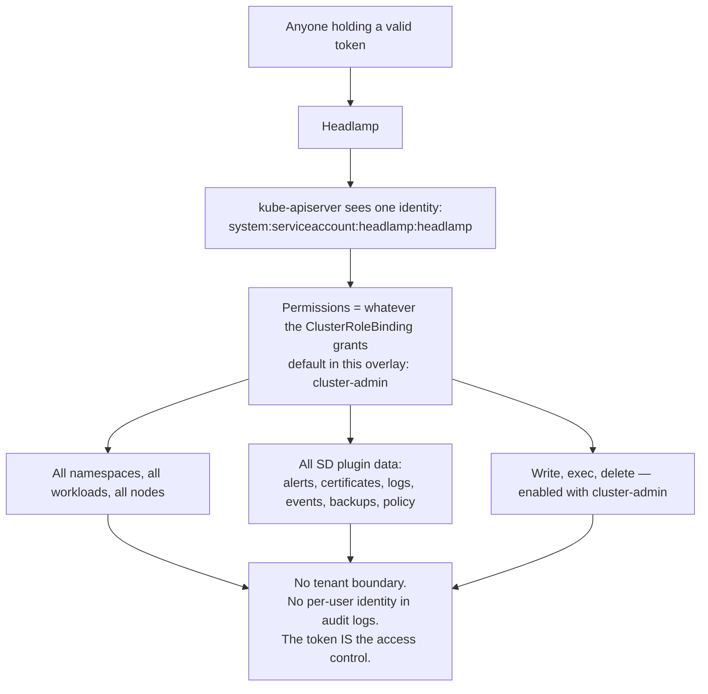

# Example: Headlamp with a ClusterRoleBinding (token-authenticated)

<!-- <SD-DOCS> -->

The simplest way to expose Headlamp, with **no SSO stack and no ingress-level authentication**.
Headlamp runs `-in-cluster` and the ingress serves it over plain TLS. Access is protected by
**Headlamp's own Kubernetes token login**: Headlamp forwards the bearer token you supply to
the kube-apiserver on every request, so without a valid token every API call arrives as
`system:anonymous` and is denied — the UI shell loads but shows no data. You supply the
`headlamp` ServiceAccount's token, which the `ClusterRoleBinding` grants cluster access.

There is no per-user identity or tenant isolation — anyone who supplies a valid token has the
rights the `ClusterRoleBinding` grants. Use this for single-admin clusters, demos, or
environments without an SSO/OIDC stack. For multi-user SSO + per-tenant isolation, use the
[`oidc-capsule`](../oidc-capsule) example instead.

## At a glance

| | |
|---|---|
| **Front door** | NGINX Ingress, TLS only — **no authentication at the ingress** |
| **Login** | Headlamp's built-in token page; the user pastes a Kubernetes bearer token |
| **Identity at the API server** | `system:serviceaccount:headlamp:headlamp` — the same for everybody |
| **Who authorizes** | kube-apiserver RBAC, via the `ClusterRoleBinding` in this overlay |
| **Tenant isolation** | **None** |
| **Per-user audit trail** | **None** — all actions are attributed to the ServiceAccount |
| **Extra components required** | None (no Pomerium, no Dex, no Capsule) |
| **Good for** | Single-admin clusters, demos, air-gapped/no-IdP environments |

## Authentication flow



## Capabilities and multitenancy

Everything the token holder can do is decided by the single `ClusterRoleBinding` — there is no
second filtering layer anywhere in the path.



What a logged-in user gets:

| Area | Behaviour |
|---|---|
| Namespaces / workloads / nodes | Everything in the cluster |
| sd-core landing page | Full — distribution metadata, node tiles, useful links |
| sd-alerts, sd-certificates | Full (Prometheus via `services/proxy`) |
| sd-events, sd-logs | Full, cluster-wide (Loki or OpenSearch via `services/proxy`) |
| sd-backups, sd-policy | Full, cluster-wide |
| Mutating actions (scale, delete, exec, port-forward) | Allowed with `cluster-admin`; bind a read-only ClusterRole (e.g. `view`) to block them — but note `view` excludes `services/proxy` and the `furyctl-*` secrets, so several plugins will render empty |
| Multitenancy | **Not supported.** Two different people using two different tokens still act as the same ServiceAccount |

## Cluster prerequisites (desired state)

- A Kubernetes cluster with an **NGINX Ingress Controller** (this overlay uses
  `ingressClassName: nginx`).
- TLS for the ingress host — either a cert-manager **`ClusterIssuer`** (referenced by the
  ingress annotation) or your own pre-created TLS Secret.

## What this overlay adds to the base `headlamp` package

This overlay layers on top of the base package (`../../katalog/headlamp`):

| Resource | Purpose |
|---|---|
| `ClusterRoleBinding` (`clusterrolebinding.yaml`) | Binds the `headlamp` ServiceAccount to `cluster-admin`. Swap for `view` (or a custom ClusterRole) to restrict. |
| `Ingress` (`ingress.yaml`) | Plain TLS, routed straight to the `headlamp` Service (no auth annotations). |

No Deployment patch is needed: the base already runs `-in-cluster` against
`kubernetes.default.svc`, which is exactly what this mode requires.

## What you must provide

Everything this overlay needs from you. The last column records where the same value already
lives on a SIGHUP Distribution cluster — useful when wiring this into the distribution.
Distribution field names were checked against **SD v1.35.1**.

| # | Input | Where you set it | Example | On a SIGHUP Distribution cluster |
|---|---|---|---|---|
| 1 | **Headlamp hostname** | `ingress.yaml` → `spec.rules[0].host` **and** `spec.tls[0].hosts[0]` | `headlamp.example.com` | derivable from `spec.distribution.modules.ingress.baseDomain` |
| 2 | **Ingress class** | `ingress.yaml` → `spec.ingressClassName` | `nginx` | `spec.distribution.modules.ingress.nginx.type` |
| 3 | **TLS source** | `ingress.yaml` → annotation `cert-manager.io/cluster-issuer` (placeholder `kind-ca`), **or** remove it and pre-create the Secret named in `spec.tls[0].secretName` | `letsencrypt-prod` | `spec.distribution.modules.ingress.certManager.clusterIssuer.name` |
| 4 | **ClusterRole to bind** | `clusterrolebinding.yaml` → `roleRef.name` | `cluster-admin` (default) or `view` | new input — no equivalent field today |
| 5 | **Image tag** (optional) | `../../katalog/headlamp/kustomization.yaml` → `images:` transformer | `registry.sighup.io/fury/sd-ui:<tag>` | pinned by the distribution version |

Nothing else is required — this mode has **no** OIDC issuer, audience, group, Capsule or CA
inputs.

## Deploy

From this directory:

```shell
kustomize build . | kubectl apply -f -
```

## Logging in

Opening the URL loads Headlamp and lands you on its **token page** (`/c/<cluster>/token`).
Headlamp forwards the bearer token you provide to the kube-apiserver on every request (without
one, calls are `system:anonymous` and denied). Supply the `headlamp` ServiceAccount's token —
it carries the rights of the `ClusterRoleBinding`:

```shell
kubectl create token headlamp -n headlamp --duration=24h
```

## Security notes

- **The token is the access control.** The ingress is unauthenticated, so anyone who reaches
  the URL sees the token page — but without a valid Kubernetes token they cannot do anything.
- **Single shared identity, no audit trail.** Everyone using a given token acts as the same
  ServiceAccount; there is no per-user identity or tenant filtering. Treat the token as a
  shared credential — scope it (bind `view` instead of `cluster-admin` where possible) and
  rotate it. For real multi-user access with per-tenant isolation, use
  [`oidc-capsule`](../oidc-capsule).
- Because there is no front-door auth, restrict network exposure of the host accordingly.

## Choosing another model

| You need | Use |
|---|---|
| Per-user SSO identity, one shared ops view of the whole cluster | [`oidc-rbac`](../oidc-rbac) |
| Per-user SSO identity **and** per-tenant namespace isolation | [`oidc-capsule`](../oidc-capsule) |

<!-- </SD-DOCS> -->
